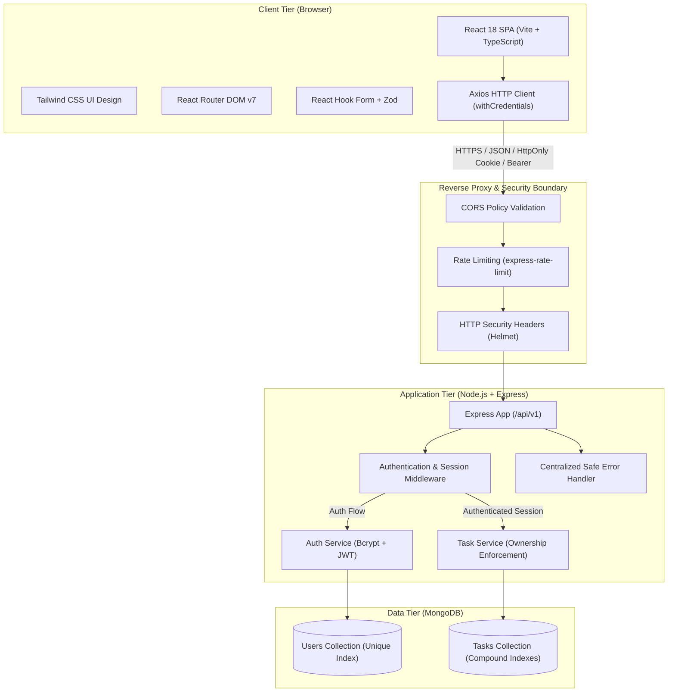
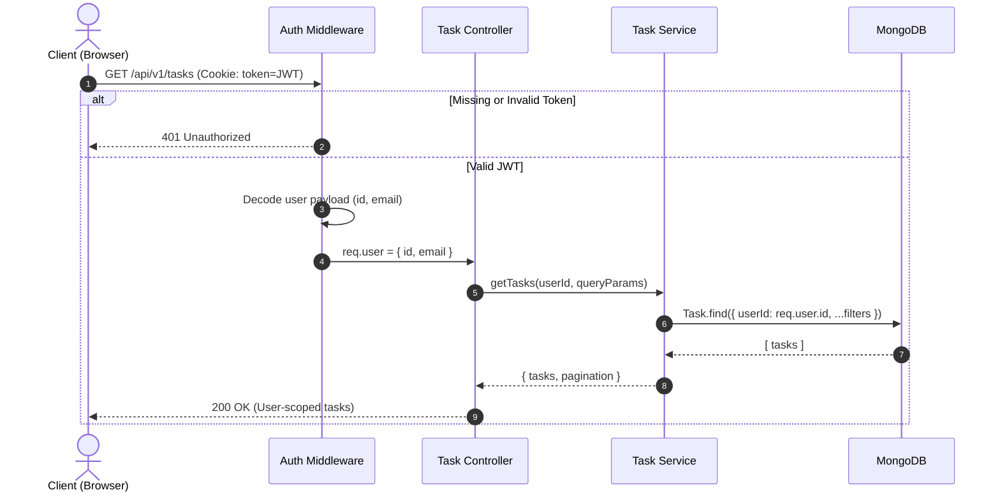
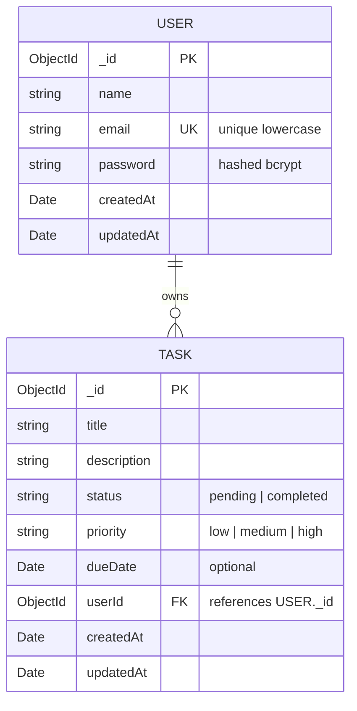

# System Architecture & Technical Design

## 1. Executive Summary

The **Task Manager Full-Stack Application** (`task-manager-fullstack`) is a decoupled, multi-tier web application built with modern engineering best practices, security-in-depth principles, and cloud-ready infrastructure.

## 2. High-Level Architecture Diagram



## 3. Security Architecture & Threat Mitigation

### 3.1 Authentication & Session Strategy
- **Password Hashing**: Uses `bcryptjs` with salt round factor of 12. Passwords are never stored in plain text and are stripped automatically from all Mongoose `toJSON()` responses.
- **Session Tokens**: Uses JSON Web Tokens (JWT) signed with secret key (`JWT_SECRET`) and configurable expiration (`7d`).
- **Storage & Transport**: Tokens are transported via `HttpOnly`, `SameSite: Lax` (or `None` in cross-site production), and `Secure` (production) cookies. A dual-token mechanism also accepts the `Authorization: Bearer <token>` header, ensuring complete compatibility with API clients, testing suites, and web browsers.
- **Token Revocation & Logout**: The `/api/v1/auth/logout` endpoint explicitly invalidates the cookie and clears local storage.

### 3.2 Authorization & Insecure Direct Object Reference (IDOR) Guard
- Every task endpoint strictly verifies ownership on the database query level:
  ```typescript
  // Always query with both task ID and authenticated user ID
  const task = await Task.findOne({
    _id: taskId,
    userId: authenticatedUserId
  });
  ```
- **Consistent Ownership Failure Policy**: If a user attempts to access, edit, or delete another user's task, the API consistently returns `404 Not Found` (rather than `403 Forbidden`). This prevents malicious actors from enumerating valid task identifiers across other accounts.

### 3.3 HTTP Security Middleware
- **Helmet**: Disables `x-powered-by`, enforces MIME type sniffing prevention, clickjacking prevention (`X-Frame-Options: SAMEORIGIN`), and cross-origin resource policy.
- **CORS Protection**: Restricted to explicitly configured origin (`CLIENT_URL` / `http://localhost:5173`).
- **Body Size Limits**: JSON and URL-encoded body parsers are restricted to `100kb` to protect against payload flood Denial-of-Service attacks.
- **Rate Limiting**:
  - Global API: Max 300 requests per 15-minute window.
  - Sensitive Auth Endpoints (`/login`, `/register`): Max 20 requests per 15-minute window to eliminate brute-force attack vectors.

## 4. Request Lifecycle & Authentication Sequence



## 5. Database Schema & Index Design



### Database Indexes:
1. `User.email`: Unique, sparse, normalized lowercase index (`{ email: 1 }`).
2. `Task.userId`: Single-field index (`{ userId: 1 }`).
3. `Task.(userId, status)`: Compound index for filtered task queries.
4. `Task.(userId, createdAt)`: Compound index for sorted chronologically ordered user task streams.

## 6. Frontend State Architecture & Routing

- **State Management**:
  - React Context (`AuthContext`): Central authentication state with automatic persistent session recovery via `/api/v1/auth/me`.
  - Local Component State (`useState`, `useCallback`, `useMemo`): Keeps presentation performant and avoids unneeded renders.
  - Toast Notification System (`ToastContext`): Real-time feedback for all user actions.
- **Form Management**: `react-hook-form` paired with `zodResolver` ensuring strict client-side validation that mirrors backend schemas.
- **Route Protection**:
  - `<ProtectedRoute>`: Restricts `/dashboard` to authenticated users; remembers target URL for post-login redirect.
  - `<PublicRoute>`: Redirects already-authenticated users from `/login` and `/register` directly to `/dashboard`.
